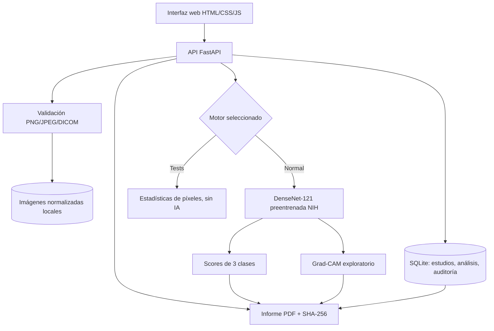

# 02 · Diseño, requisitos y arquitectura

## Arquitectura originalmente diseñada en NF2

El diseño proponía una **interfaz web**, API FastAPI, capa de ingesta/QA DICOM–PNG, procesamiento PyTorch/MONAI, DenseNet-121 multietiqueta, Grad-CAM, reglas experimentales y abstención, SQLite y PDF. DuckDB/Parquet, autenticación ampliada y contenedores se consideraron extensiones opcionales.

- [Diagrama de arquitectura histórica](arquitectura.svg)
- [Diagrama de entidades previsto en NF2](modelo_datos.svg)

Ambos diagramas ilustran el **diseño**, no certifican que todos esos módulos se implementasen. El modelo de datos real de NF3 se simplificó a tablas de estudios, análisis y eventos de auditoría.

## Arquitectura implementada en NF3

El modelo de IA se descarga como dependencia externa y sus pesos **no se incluyen en Git**. Las radiografías del conjunto de ensayo se versionan por separado en `examples/nih/radiografias/`, sin introducir archivos de pacientes aportados por usuarios.

## Correspondencia con los requisitos de NF2

| ID | Requisito del diseño | Estado NF3 | Alcance real / límite |
|---|---|---|---|
| RF01 | Carga PNG/DICOM | Implementado | PNG/JPEG; DICOM CR/DX monocromático con restricciones |
| RF02 | QA y control de metadatos | Parcial | Formato, resolución y metadatos habituales; no detecta texto identificativo en todos los píxeles |
| RF03 | Ingesta trazable | Implementado | ID, SHA original, formato y fecha; coincidencia NIH por hash |
| RF04 | Clasificador multietiqueta | Adaptado | DenseNet-121 **preentrenada**; no se ha entrenado desde cero |
| RF05 | Grad-CAM | Implementado técnicamente | Overlay disponible; sin validación anatómica de zonas |
| RF06 | Reglas de prioridad y abstención | Abstención | `SIN_RESULTADO` en todos los casos; sin reglas médicas validadas |
| RF07 | Visor e informe | Implementado | Interfaz e informe PDF de dos páginas |
| RF08 | Persistencia y auditoría | Implementado | SQLite + SQLAlchemy, migraciones aditivas, historial recuperable |
| RF09 | Evaluación reproducible | Parcial | Tests funcionales y muestra descriptiva de 20; no AUROC/AUPRC clínicamente interpretables |

## Componentes reales y contratos

| Módulo | Función |
|---|---|
| `src/tria/api.py` | Endpoints HTTP, control de errores, orquestación, descarga de informes |
| `src/tria/image_io.py` | Carga, normalización, validaciones y cálculo de SHA-256 |
| `src/tria/provenance.py` | Correspondencia entre archivo importado y muestra NIH por hash |
| `src/tria/database.py` | Tablas y consultas SQLite, historial y auditoría |
| `src/tria/inference.py` | Motor demo técnico y adaptador TorchXRayVision |
| `src/tria/gradcam.py` | Superposición de activaciones |
| `src/tria/report.py` | PDF de la ejecución con imágenes, resultados y huellas |
| `src/tria/web/*` | Interfaz, estados, historial y exportación |

### Endpoints principales

`GET /health`, `GET /api/v1/system`, `POST /api/v1/studies`, `GET /api/v1/studies`, `GET /api/v1/studies/{id}`, `POST /api/v1/studies/{id}/analyses`, `GET /api/v1/analyses/{id}`, `GET /api/v1/analyses/{id}/heatmap` y `GET /api/v1/analyses/{id}/report`. La especificación OpenAPI se puede consultar en `/docs` cuando el servidor está iniciado.

## Diferencias deliberadas frente a NF2

- **MONAI no es una dependencia obligatoria** en el MVP; se optó por los transformadores de TorchXRayVision y torchvision para ejecutar un checkpoint disponible y probado.
- **Sin entrenamiento propio** ni métricas derivadas de un split independiente. Las predicciones publicadas son salidas del modelo, no pruebas de efectividad clínica.
- **Sin motor real de prioridad:** un diagnóstico radiológico estimado no permite deducir urgencia, y NF2 no aportaba etiquetas de urgencia verificadas.
- **Sin RSNA en NF3**: el soporte DICOM se comprueba con ficheros sintéticos, no se mezclan etiquetas de neumonía RSNA con clases NIH.
- **Sin cuentas ni despliegue externo:** aplicación local para la rúbrica de reproducibilidad; no se ha desarrollado una infraestructura hospitalaria.
